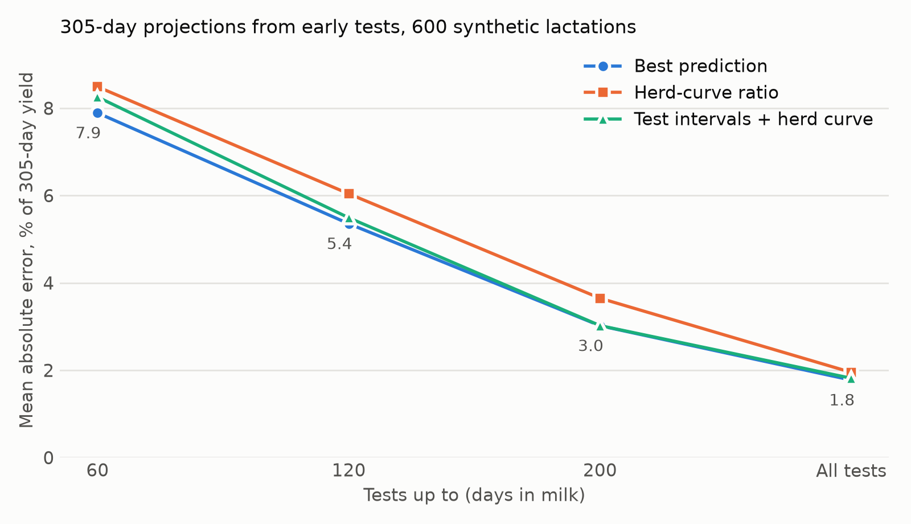

# bestpred

[](https://doi.org/10.5281/zenodo.23425506)

Python translation of the USDA best prediction of lactation yields (BESTPRED).

Takes a cow's test days and returns 305-day, 365-day and to-date milk, fat, protein and SCS (actual and mature
equivalent), persistency, reliabilities, the data collection rating, and the cow's daily lactation curve.

Best prediction is the method USDA has used for official lactation records since 1998 (VanRaden, 1997; Cole et al.,
2009). The original is USDA-AGIL's public-domain Fortran and C,
[BESTPRED 2.0rc7](https://github.com/wintermind/bestpred). This port gives the same numbers.

## How it was checked

USDA's code was compiled from source, and both programs ran on the same random lactations: 1 to 15 test days,
duplicate tests, LER segments, 3X milking, owner-sampler and unusable supervision codes, missing components, all six
breeds, parities 1 to 9, herd means present and absent.

- **Every output and the full daily curves agree to 1e-9 relative** (typically 1e-12) for 300 lactations under each
  of 13 settings: the default, single-trait, multi-trait with SCS, the three 3X options, 365-day and 330-day
  lactations, linear, region, calving-season and region-by-season curves, and kilograms.
- **Mature-equivalent factors agree bit for bit** (aiplage and adjscs) on 43,200 combinations of breed, state, year,
  month, parity, previous days open and age base.
- **USDA's example record** gives the same results line as their program, character for character.

`tests/` holds fixtures from that reference build, so `pytest` runs without a Fortran compiler. To rebuild the
reference and run the full comparison yourself (needs gcc and gfortran):

```bash
tools/reference.sh /tmp/bestpred-ref
python tools/compare.py --driver /tmp/bestpred-ref/driver --n 300
```

## Tested against daily meter weights

600 synthetic lactations shaped like a California Holstein herd. 305-day yield projected from test days drawn
monthly from daily weights, compared with the true daily total.



Method, data, table and scripts: [validation/](validation/).

## For AI agents

An agent can't work out a lactation record in its head, but it can run this. `bestpred-mcp` puts best prediction
behind four tools any agent can call (Claude, ChatGPT and Codex, Cursor, VS Code, Gemini CLI):

```bash
uvx bestpred-mcp
```

- **Claude Code:** `claude mcp add bestpred -- uvx bestpred-mcp`, or the plugin with its skill:
  `claude plugin marketplace add padge01/bestpred-python` then `claude plugin install bestpred@bestpred`
- **Claude Desktop, Cursor, Gemini CLI:** `{ "mcpServers": { "bestpred": { "command": "uvx", "args": ["bestpred-mcp"] } } }`
- **Codex** (`~/.codex/config.toml`): `[mcp_servers.bestpred]` with `command = "uvx"` and `args = ["bestpred-mcp"]`

Then: "Work out 305-day milk for every cow in `tests.csv`." The tools take a herd's test-day export (DHI or DairyComp
columns), one cow's test days, a cow's expected daily curve, and USDA's age factors. Details in [mcp/](mcp/).

## Install

```bash
pip install bestpred
```

Python 3.10 or later, NumPy only.

## Use it

From Python, with test days as a DHI test or a parlor export gives them:

```python
from bestpred import TestDay, bestpred

tests = [
    TestDay(dim=12, milk=78.0, fat=4.4, protein=3.2, scs=3.1),
    TestDay(dim=43, milk=96.5, fat=3.7, protein=2.9, scs=2.0),
    TestDay(dim=71, milk=99.0, fat=3.5, protein=3.0, scs=1.8),
    TestDay(dim=104, milk=94.2, fat=3.6, protein=3.1, scs=2.4),
]
res = bestpred(tests, herdavg=(26000, 980, 800, 2.8), agefac=(1, 1, 1, 1), cowid='H', parity=2,
               fresh='20260301')

res.yields('actual')['milk']['305']   # projected 305-d milk, lb
res.rel_yield[0]                      # reliability of that projection
res.persistency[0]                    # milk persistency (SD units, 0 is average)
res.daily_herd[1, 0] + res.daily_bp[1, 0]   # the cow's predicted daily milk, days 0..365 (slot 0 unused)
```

| Argument | Meaning |
|---|---|
| `herdavg` | Herd 305-d mature-equivalent milk, fat, protein (lb or kg) and mean SCS. 0 for unknown: the breed mean is used. |
| `agefac` | Factors that turn actual into mature-equivalent yield. `bestpred.age_factors()` computes USDA's; `(1, 1, 1, 1)` leaves yields as they are. |
| `cowid` | Only the first letter matters: breed A, B, G, H, J or M. |
| `TestDay.super` | Supervision code: 1 supervised, 2 owner-sampler, 0 or 4 unusable, and so on as in Format 4. |
| `times_milked`, `times_weighed`, `times_sampled` | Milkings that day and how many were weighed or sampled (AM-PM testing). |
| `mrd` | Days averaged into a test (1 for a normal test day; more for LER). |

`bestpred.Settings` holds the options from USDA's `bestpred.par`: single- or multi-trait, the 3X adjustment, lactation
length, which standard curves, and pounds or kilograms.

USDA Format 4 records run straight from the command line and give the program's `results_v2.dcr` lines, or JSON:

```bash
bestpred records.dat
bestpred records.dat --json
```

## Things the port keeps from the original

The aim is the same numbers as USDA's program, so behavior that changes results is kept and marked `sic` in the code.
Worth knowing:

- When a herd mean is missing, the breed mean is taken from the 1995 table for first lactations and the 2000 table
  for later ones (the year-group index is the parity group).
- The partial-record 3X factor compares the last test against `end1` (capped at 305 days) instead of `end2`.
- Duplicate test days are dropped (the first is kept); overlapping LER segments are shortened.
- USDA's command-line program replaces a record's length with its last test day (`--keep-length` turns that off
  here), and its parameter reader quietly resets the calving-season curves (C, T, D, U) to linear. Programs that call
  the routine directly can use them, and so can this package.

Found while porting:

- With bounds checking on (`-fcheck=all`), the original stops when the last usable test day has no usable yield: a
  plotting loop reads one element before an array. USDA's production build has no bounds checking, and the results
  don't use that value.
- An SCS age adjustment can land exactly on .5. Compilers that fuse multiply-adds (by default on Apple silicon)
  round it the other way from plain IEEE double arithmetic. This port gives the plain result, as on x86.

## References

- VanRaden, P.M. 1997. Lactation yields and accuracies computed from test day yields and (co)variances by best
  prediction. J. Dairy Sci. 80:3015–3022.
- Cole, J.B., D.J. Null, and P.M. VanRaden. 2009. Best prediction of yields for long lactations. J. Dairy Sci.
  92:1796–1810.
- Cole, J.B., and P.M. VanRaden. 2008. A manual for use of BESTPRED: a program for estimation of lactation yield and
  persistency using best prediction. USDA-ARS-AGIL.

## License

The port is Apache-2.0. The original is public domain, written by employees of the US government. Its notice is
reproduced in full in [NOTICE](NOTICE), as it asks. This package is not a product of, or endorsed by, USDA.

Ported by Pádraig Lucey ([dairydatascience.com](https://dairydatascience.com)).
